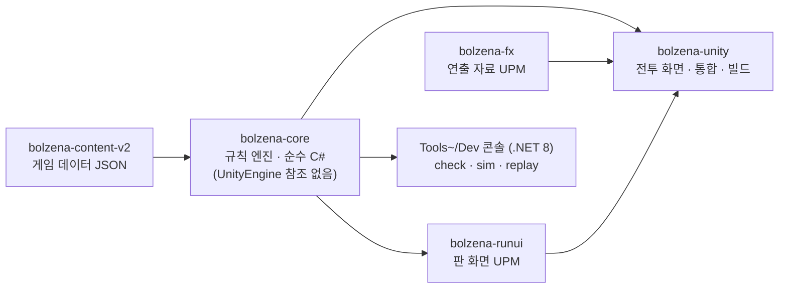

# 볼제나

트릭컬 리바이브 사도들로 하는 카제나식 덱빌딩 로그라이크 — **비공식 팬 게임 · 비영리**.
Unity 6 · C# 1인 개발. 규칙 엔진을 엔진 밖 순수 C# 으로 떼어 내고, 테스트 · 데이터 검사기 · 봇 시뮬레이션으로 검증하며 만들었습니다.

- **플레이**: https://bolzena.pages.dev (Unity WebGL · 데스크톱 브라우저)
- 예전 웹(JS)판: [`web-legacy`](../../tree/web-legacy) 브랜치 · `web-final` 태그

<!-- TODO: 스크린샷 2장(전투 · 지도) + 1~2분 플레이 영상 링크 -->

## 한눈에 보기

| | |
|---|---|
| 직접 쓴 C# | 349파일 · 약 9.4만 줄 (Spine 런타임 제외) |
| 자동 테스트 | NUnit 68파일 · 테스트 약 800개 (`bolzena-core/Tests/Editor`) |
| 데이터 검사기 | 사도 20 · 카드 244 · 적 188 · 이벤트 61 · 장비 64 — 오류 0 |
| 개발 기간 | 웹(JS)판 2026-09-30 → Unity판 2026-10-04 ~ |
| 운영 | 공개 웹판 · 판 기록 자동 수집 · 시즌 랭킹(점수는 리플레이로 검증) |

## 구조

| 폴더 | 내용 |
|---|---|
| `bolzena-core/` | 규칙 엔진 UPM 패키지 — 키워드 · 전투 · 판 · 봇 · 시뮬 · 검사기 · 입력 테이프, `Tools~/Dev` 콘솔 |
| `bolzena-runui/` | 판 화면 UPM 패키지 — 로비 · 마을 · 편성 · 지도 · 상점 · 이벤트 · 보상 · 도감 · 설정 |
| `bolzena-unity/` | Unity 6 본 프로젝트(URP · spine-unity 4.1) — 전투 화면 · 통합 · 빌드 |
| `bolzena-fx/` | 연출 자료 UPM 패키지 — 이펙트 변환 · 모션 표 · 소리 규칙 |
| `bolzena-content-v2/` | 게임 데이터(JSON, 스키마 `bolzena-core/Docs/schema`) — 사도 · 적 · 마을 · 이벤트 · 장비 · 교주 카드 |

**왜 이렇게 나눴나**

- **규칙을 화면에서 떼어 냄** — 웹판에서 규칙과 화면이 얽혀 고치기 어려웠던 것이 계기입니다. 엔진은 UnityEngine 을 모르고, 화면은 [`Docs/API.md`](bolzena-core/Docs/API.md) 의 함수만 부릅니다. 엔진은 실패를 예외 대신 까닭 글로 돌려주고, 화면은 그 글을 그대로 보여 줍니다.
- **엔진 없이 수천 판을 돌림** — 같은 코어를 .NET 8 콘솔로 빌드해 봇이 판을 병렬로 끝까지 돌립니다(`bz sim`). 밸런스 조정은 이 숫자로 합니다.
- **결정론 리플레이** — 전투 입력을 테이프(JSON)로 남기고 처음부터 다시 돌려 턴마다 지문이 같은지 봅니다. .NET 8 에서 뜬 테이프를 Unity(Mono)에서 돌려도 같아야 통과합니다. 랭킹에 올라오는 점수는 이 리플레이로 검증합니다.

## 검증 방식

| 무엇을 | 어떻게 |
|---|---|
| 규칙 | NUnit 테스트 약 800개 — 키워드 · 전투 · 판 진행 · 보상 · 리플레이 · 콘텐츠 스키마 |
| 데이터 | `bz check` — 참조 무결성, 카드 효과 수, 신탁(강화)이 기본보다 나은가 등 규칙 위반을 오류/주의로 출력 |
| 밸런스 | 봇 시뮬레이션(`RunBot` · `RunBotSkilled` · `MetaSim`) + 실제 플레이어 판 기록 |

공개판은 판이 끝날 때마다 기록(전투 요약 · 턴별 카드 · 선택)을 익명으로 보내고(설정에서 끌 수 있음), `bz records` 가 같은 편성의 숙련 봇과 나란히 집계합니다.
2026-10-27 기준 사람 177판(끝난 판) 완주 60.5% · 숙련 봇 61.7% 로 거의 같고, 차이는 1층 일반 싸움(사람 7.9% · 봇 1.7% 쓰러짐)에 남아 있습니다.
초기 24판만 보고 1층 피해를 내렸다가 94판이 모이자 되돌린 일이 있어, 지금은 표본이 쌓이기 전에는 조정하지 않습니다.

## AI 활용

코드 대부분은 AI 코딩 도구(Claude Code)로 작성했습니다. 제가 맡은 일은 설계 결정, 검증 기준 정하기, 결과를 받아들일지 판단하기입니다.
AI 가 쓴 변경은 위의 테스트 · 검사기 · 봇 시뮬레이션을 통과해야 들어갑니다.

## 빌드

1. Unity 6000.6.4f1 (Windows · WebGL 모듈). 패키지는 `bolzena-unity/Packages/manifest.json` 에서 `file:../../bolzena-*` 로 붙어 있으니 이 폴더 구조 그대로 받아야 열립니다.
2. 원작 에셋은 각자 준비해야 합니다 — `bolzena-unity/Tools/copy_assets.py` · `copy_run_assets.py` 가 로컬 에셋 폴더에서 필요한 것만 프로젝트로 복사합니다(경로는 스크립트 안).
3. 데이터 검사: `bolzena-core/Tools~/Dev/bz.cmd check --data <bolzena-content-v2 경로>`
4. PC: `bolzena-unity/Tools/build.sh` · 웹: `bolzena-unity/Tools/build_web.sh`(25MB 넘는 파일은 조각으로 나눔).

## 저작권

> 트릭컬 리바이브의 그림 · 음성 · 설정의 저작권은 EPID Games 에 있습니다. 이 저장소와 게임은 공식과 무관하며, 권리자의 요청이 있으면 즉시 내립니다.
> 원작 에셋(스파인 · 그림 · 소리)은 이 저장소에 들어 있지 않습니다.
